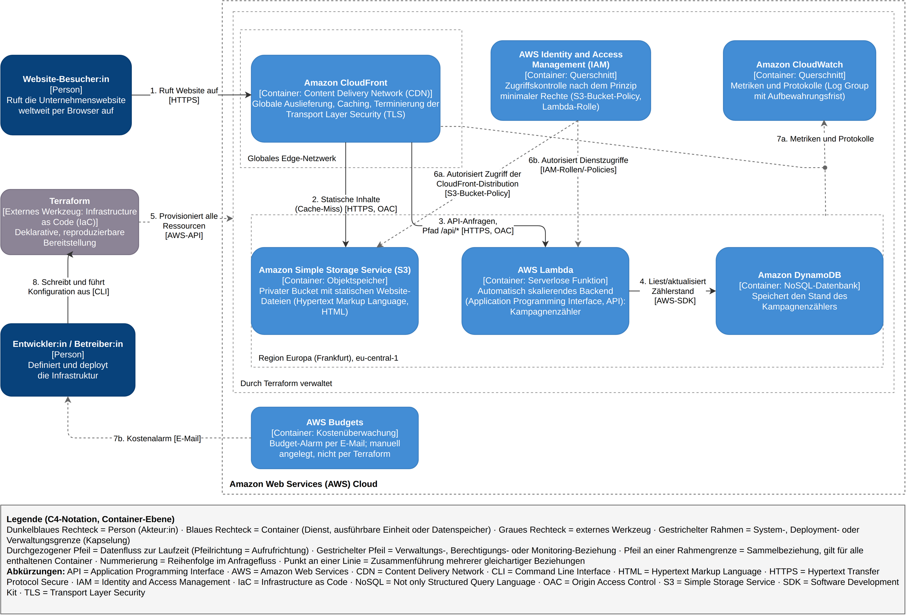

# AquaVita e. V. – Unternehmenswebsite auf AWS mit Terraform

Portfolio-Projekt *Cloud Programming* (IU Internationale Hochschule). Eine statische Website mit einem Kampagnenzähler, vollständig serverlos auf AWS betrieben und reproduzierbar per Terraform bereitgestellt.



Stand der Umsetzung (Phase 2). Das in Phase 1 abgenommene Diagramm liegt zum Vergleich unter [`docs/architecture-c4.png`](docs/architecture-c4.png).

## Architektur

| Komponente | Dienst | Aufgabe |
|---|---|---|
| Auslieferung | Amazon CloudFront | CDN mit HTTPS; Default-Origin S3, `/api/*` an Lambda – beide per Origin Access Control (OAC) |
| Content | Amazon S3 | privater Bucket (Block Public Access), enthält `index.html` |
| Backend | AWS Lambda (Function URL) | `GET /api/count` erhöht den Kampagnenzähler; Function URL mit `AWS_IAM`, nur über CloudFront erreichbar |
| Daten | Amazon DynamoDB | Tabelle für den Kampagnenzähler, Provisioned Mode 25 RCU / 25 WCU |
| Zugriff | AWS IAM | Lambda-Rolle darf nur `GetItem`/`UpdateItem` auf die eine Tabelle und Logs in die eine Log Group schreiben |
| Monitoring | Amazon CloudWatch | Log Group der Lambda mit begrenzter Aufbewahrung |

Es gibt keine Anwendungs-Secrets: Alle Dienste authentifizieren sich untereinander über IAM-Rollen bzw. SigV4. AWS-Credentials kommen ausschließlich aus der lokalen SSO-Konfiguration.

## Voraussetzungen

- [Terraform](https://developer.hashicorp.com/terraform/install) **1.16.3** (über [tfenv](https://github.com/tfutils/tfenv) aus `.terraform-version`)
- [AWS CLI v2](https://docs.aws.amazon.com/cli/latest/userguide/getting-started-install.html)
- AWS-Profil `iu-cloud` über [IAM Identity Center (SSO)](https://docs.aws.amazon.com/cli/latest/userguide/cli-configure-sso.html)
- Ein AWS Budget als Kostenbremse, manuell angelegt **vor** dem ersten `apply` (bewusst nicht in Terraform)

## Bootstrap (einmalig)

Der Terraform-State liegt in einem separaten S3-Bucket mit nativem State-Locking (`use_lockfile = true`). Dieser Bucket ist Werkzeugkette, nicht Teil der Anwendung, und wird deshalb einmalig per CLI angelegt statt von Terraform verwaltet:

```bash
aws sso login --profile iu-cloud
export AWS_PROFILE=iu-cloud
export TF_STATE_BUCKET="aquavita-tfstate-iu-cloud"

aws s3api create-bucket --bucket "$TF_STATE_BUCKET" --region eu-central-1 \
  --create-bucket-configuration LocationConstraint=eu-central-1

aws s3api put-bucket-versioning --bucket "$TF_STATE_BUCKET" \
  --versioning-configuration Status=Enabled

aws s3api put-public-access-block --bucket "$TF_STATE_BUCKET" \
  --public-access-block-configuration \
  "BlockPublicAcls=true,IgnorePublicAcls=true,BlockPublicPolicy=true,RestrictPublicBuckets=true"

aws s3api put-bucket-encryption --bucket "$TF_STATE_BUCKET" \
  --server-side-encryption-configuration \
  '{"Rules":[{"ApplyServerSideEncryptionByDefault":{"SSEAlgorithm":"AES256"}}]}'
```

## Bereitstellung

```bash
aws sso login --profile iu-cloud

cd infra
cp terraform.tfvars.example terraform.tfvars   # Werte prüfen, Datei ist gitignored

terraform init      # Provider exakt nach .terraform.lock.hcl, S3-Backend
terraform plan
terraform apply
```

Das Anlegen der CloudFront-Distribution dauert mehrere Minuten. Nach dem `apply` gibt Terraform u. a. `cloudfront_domain_name` aus; die Website ist unter `https://<cloudfront_domain_name>` erreichbar.

## Überprüfung

Alle Befehle im Verzeichnis `infra/`:

```bash
DOMAIN=$(terraform output -raw cloudfront_domain_name)

# Website und Kampagnenzähler über CloudFront
curl -s "https://$DOMAIN/api/count"                    # {"count":<n>}

# Caching: erster Aufruf "Miss from cloudfront", zweiter "Hit from cloudfront"
curl -sI "https://$DOMAIN/" | grep -i x-cache
curl -sI "https://$DOMAIN/" | grep -i x-cache

# Direkter Zugriff am CDN vorbei ist gesperrt
curl -s -o /dev/null -w '%{http_code}\n' \
  "https://$(terraform output -raw site_bucket_name).s3.eu-central-1.amazonaws.com/index.html"   # 403
curl -s -o /dev/null -w '%{http_code}\n' \
  "$(terraform output -raw lambda_function_url)api/count"                                        # 403
```

## Inhalt aktualisieren

Nach einer Änderung an `src/site/index.html` lädt `terraform apply` die Datei neu hoch. Da CloudFront die Seite zwischenspeichert, muss der Cache anschließend [invalidiert](https://docs.aws.amazon.com/AmazonCloudFront/latest/DeveloperGuide/Invalidation.html) werden:

```bash
aws cloudfront create-invalidation --profile iu-cloud \
  --distribution-id "$(terraform output -raw cloudfront_distribution_id)" \
  --paths "/index.html"
```

## Abbau

```bash
terraform destroy
```

Entfernt alle Ressourcen inklusive Bucket-Inhalt (`force_destroy = true`) und Zählerstand. Der State-Bucket aus dem Bootstrap bleibt bestehen.

## Projektstruktur

```
├── .terraform-version          # gepinnte Terraform-Version
├── docs/
│   ├── architecture-c4_P2.drawio.png   # Architekturdiagramm (C4), Stand Phase 2, mit eingebetteter draw.io-Quelle
│   └── architecture-c4.png             # Architekturdiagramm, Stand Phase 1
├── src/
│   ├── site/index.html         # Website mit Kampagnenzähler
│   └── lambda/index.mjs        # Lambda-Handler für GET /api/count
└── infra/                      # ein Root-Modul, nach Architekturkomponenten aufgeteilt
    ├── versions.tf             # Terraform- und Provider-Versionen
    ├── backend.tf              # S3-Backend mit use_lockfile
    ├── providers.tf            # AWS-Provider, default_tags
    ├── variables.tf / locals.tf
    ├── storage.tf              # S3-Content-Bucket, index.html
    ├── database.tf             # DynamoDB
    ├── iam.tf                  # Lambda-Ausführungsrolle
    ├── compute.tf              # Lambda, Function URL, Log Group
    ├── cdn.tf                  # CloudFront, OACs, Bucket-Policy, Lambda-Permissions
    ├── outputs.tf
    ├── terraform.tfvars.example
    └── .terraform.lock.hcl     # committed: fixiert Provider-Versionen und -Hashes
```

## Hinweise

- Account-IDs sind in allen Screenshots der Dokumentation geschwärzt.
- `terraform.tfvars` ist gitignored; `terraform.tfvars.example` zeigt die erwarteten Werte.
- Der Lockfile `.terraform.lock.hcl` ist bewusst committet – erst er macht `terraform init` reproduzierbar.

## Dokumentation

- Terraform: [CLI-Befehle](https://developer.hashicorp.com/terraform/cli/commands) · [S3-Backend](https://developer.hashicorp.com/terraform/language/backend/s3) · [Dependency Lock File](https://developer.hashicorp.com/terraform/language/files/dependency-lock) · [AWS-Provider](https://registry.terraform.io/providers/hashicorp/aws/latest/docs)
- AWS: [CloudFront OAC für S3](https://docs.aws.amazon.com/AmazonCloudFront/latest/DeveloperGuide/private-content-restricting-access-to-s3.html) · [CloudFront OAC für Lambda](https://docs.aws.amazon.com/AmazonCloudFront/latest/DeveloperGuide/private-content-restricting-access-to-lambda.html) · [Lambda Function URLs – Zugriffskontrolle](https://docs.aws.amazon.com/lambda/latest/dg/urls-auth.html) · [DynamoDB Provisioned Capacity](https://docs.aws.amazon.com/amazondynamodb/latest/developerguide/provisioned-capacity-mode.html)
